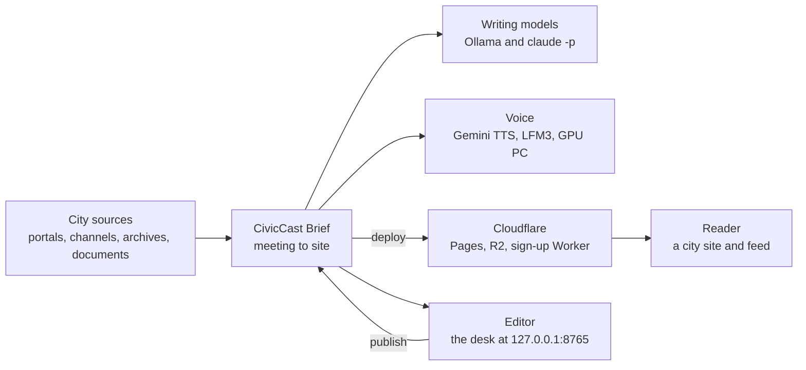
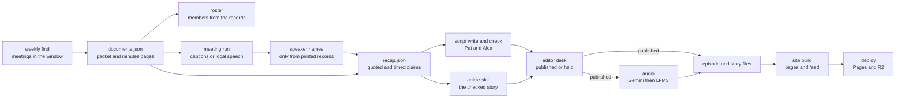
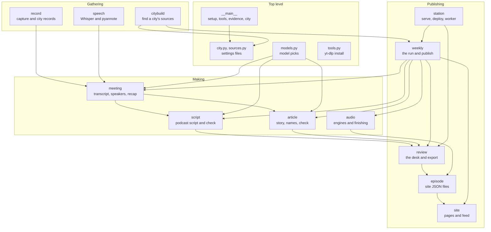
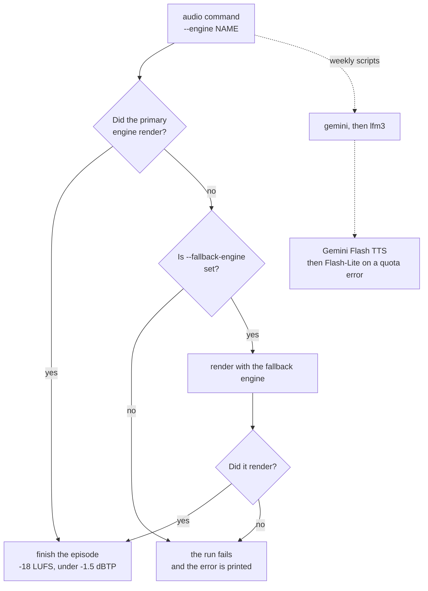
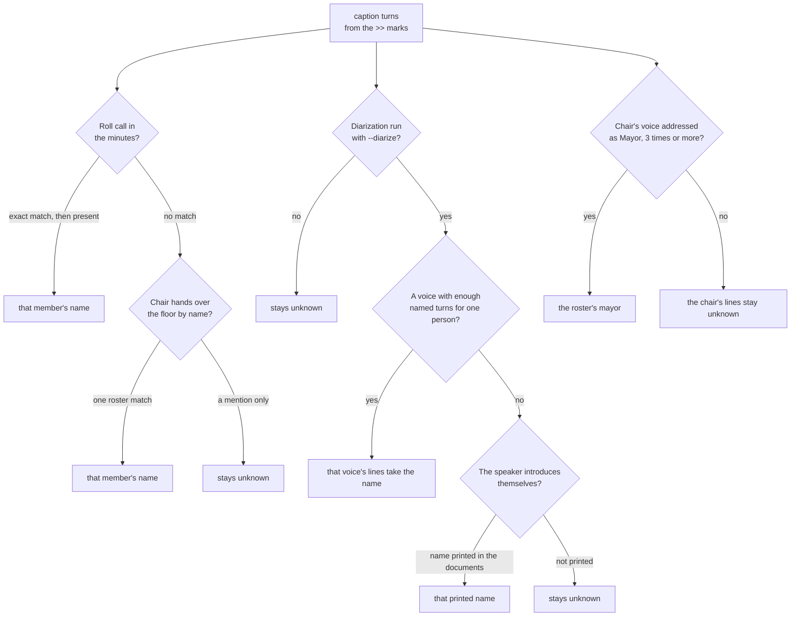
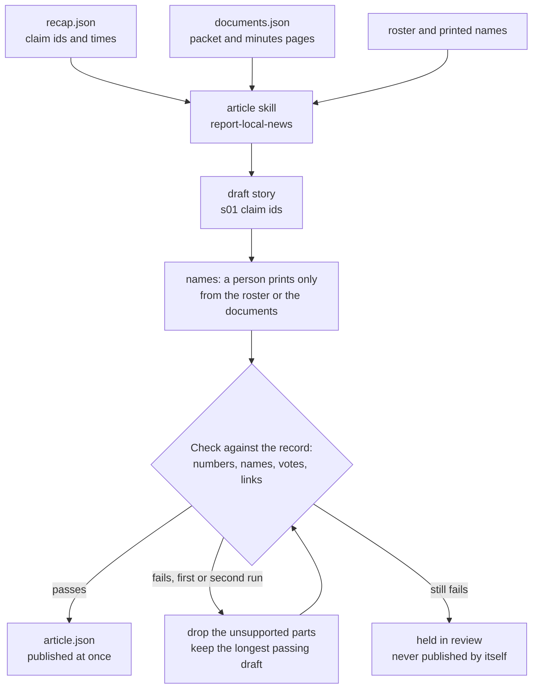
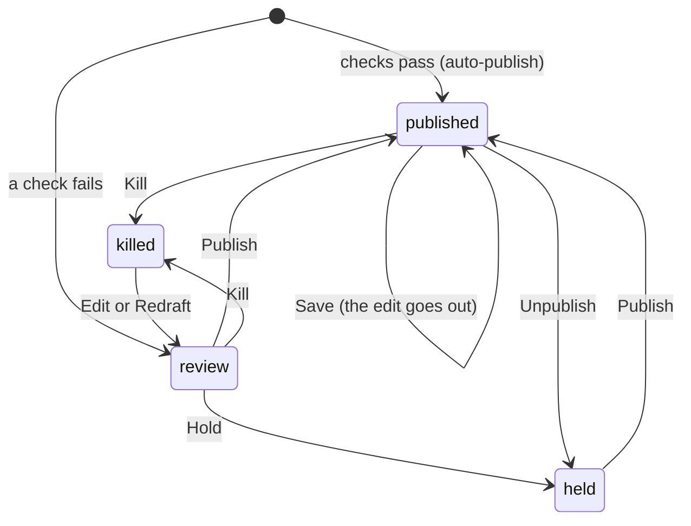
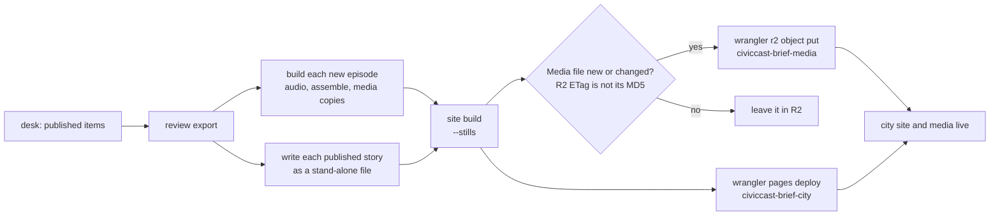
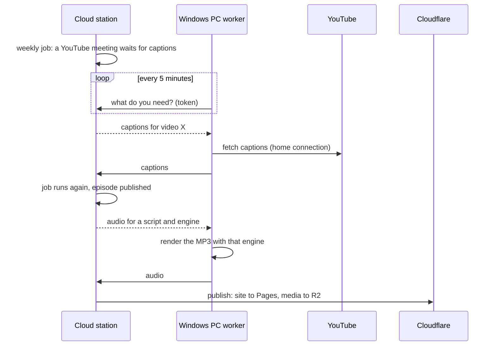

# CivicCast Brief user manual

This manual covers **CivicCast Brief 0.5.0**. It has four parts:

1. [New users](#1-new-users): what the program is and your first hour with it.
2. [Editors (no technical background needed)](#2-editors): the desk, the buttons, and what readers see.
3. [Technical users](#3-technical-users): install, commands, settings files, hosting and the PC worker.
4. [Architecture](#4-architecture): how the parts fit, with diagrams.

The step-by-step setup guide is [set-up-a-city.md](set-up-a-city.md). This manual explains the
whole program and points to that guide for exact command options.

---

## 1. New users

### What CivicCast Brief does

CivicCast Brief answers one question for a town: *what did my local government just do?*

It reads a city's public meeting videos and documents and makes four things from each meeting:

- a **transcript** with times and, where the records allow, speaker names;
- a **recap** where every claim quotes the meeting word for word, with the time it was said;
- a **news story** where every paragraph, vote and quote links to its moment in the video or its
  page in the packet or minutes;
- a **podcast episode** with two hosts, Pat and Alex, chapters and a transcript.

It then builds a **city website** with the stories, an audio player, transcript pages, board,
topic and monthly archive pages, search, a sitemap and a podcast feed. An example is live at
[longmont.civiccastbrief.org](https://longmont.civiccastbrief.org).

### What it will not do

- It does not make things up. A checker drops any claim, number or name that is not in the
  meeting's own words or documents.
- It does not guess who is speaking. A speaker is named only when a city record prints the name
  (the roll call, the member list, the agenda, the packet or the minutes). Everyone else stays
  "unknown".
- It is not a full newsroom. There are no beats, opinion pieces, records requests or ads.

### What you need

- A Windows 11 PC. The program is built and tested on Windows.
- Google Chrome (some city sites can only be read through it). The `browser` extra
  (installed by `install.ps1`) lets the program drive it.
- Ollama for the default writing model, and Claude Code signed in to a Claude subscription for the
  weekly story writer (the report-local-news skill runs the `claude` CLI).
- For audio, one of:
  - a Gemini TTS API key (a Google API key kept in `GEMINI_API_KEY` or Windows Credential
    Manager), which is what the live weekly runs use first;
  - LFM3 through `llama-tts` on the PC, which needs no key and no GPU;
  - Dia2 or Chatterbox on a separate Windows PC with an NVIDIA GPU, reached over ssh (optional).

The PC's own CPU is enough for LFM3. No NVIDIA GPU is needed for the weekly voice chain.

The desk's **This computer** page checks all of this on your PC: ffmpeg, yt-dlp, Chrome, Ollama
with the writer model, Claude Code and its sign-in, and a voice engine. Each row says what it
found and what to do about anything missing.

### Your first hour

1. **Install.** Double-click `install.cmd` in a copy of the code, or run the one-line command in
   [Install](#install). It installs everything for your user, with no administrator rights, and
   says what is still missing.
2. **Open the desk.** Double-click `desk.cmd`. Your browser opens the editor desk at
   `http://127.0.0.1:8765/`. Keep the desk's window open; closing it stops the desk. A new
   install opens on the **setup wizard**: this computer, the cities, finding and checking their
   sources, rosters, models and voices, the website, a test meeting, and the weekly job, for one
   city or several at once. Once a city exists the home page is the city list, with its **Set up**
   link back to the wizard.
3. **Finish on Everything works.** The wizard's last page reads this computer and every city's
   files and shows one line for each thing: **This computer**, the **Windows task**, then per
   city **Sources** (how many, each READ), **Rosters** (files and members), **Test brief** (the
   test meeting waiting in Items), **Every week** (the schedule and its next run), and
   **Website** (none, or built and when). Each line is OK or Needs work with one sentence and a
   link to the page that fixes it. A website chosen before any brief is published shows
   "The website is built after you publish a brief on the desk." — that is not a problem; the
   site appears after the first brief is published.
4. **Find your city's sources.** On the desk, go to **Sources > Find a city's sources**. Type the
   city's name and state (and its website if you know it), press **Search**, tick what it found,
   and press **Add**.
5. **Check them.** Press **Check all sources**. Each body (council, board, commission) shows
   READ with its newest meeting, or NOT READ with the reason.
6. **Run the week.** Run the weekly command (see [The weekly run](#the-weekly-run)), or ask your
   technical person to schedule it. New meetings appear on the desk.

---

## 2. Editors

You do not need to know any code to edit. Everything here happens in the browser.

### The desk's front page

The front page is the control room:

- **Problems**: what needs you. Items that failed their checks, items still waiting for review,
  and (on a station) a weekly run that failed.
- **What went out**: everything published, each with **Edit**, **Unpublish** and **Kill**.
- On a station, it also shows the last run, the next run and any publish waiting to go out,
  with **Run now**.

Below that, every item is listed, with a tab for each state.

Until the desk is set up, the front page also shows a **Set up your city** checklist above the
list: the city, its sources, a check of those sources, the roster, the models and voices, a test
run of one meeting, and the weekly schedule. Each step links to the page that does it and ticks
when the step is really done, so there is nothing to dismiss; the panel goes away when every
required step is done. Models and voices are marked optional.

### Items and their states

An item is an **episode** (speakers, recap and podcast script) or an **article** (the news
story). Each item is in one state:

| State | Meaning | Reaches the site |
|---|---|---|
| review | waiting for an editor | no |
| held | set aside | no |
| killed | will not run until it is edited or redrafted | no |
| published | out on the site | yes |

**Auto-publish is always on.** An item that passes every check is published as soon as the
weekly run makes it. An item that fails a check is held in review and never goes out by itself.
Your job is mostly the Problems list.

### The buttons

| Button | What it does |
|---|---|
| **Save** | Keeps your edits. A published item stays published, so your change goes out. Any other item goes back to review. |
| **Publish** | Puts the item out with its exact saved text. |
| **Unpublish** | Takes a published item off the site and holds it. |
| **Hold** / **Kill** | Keeps an item off the site. A killed item needs an edit or a redraft before it can be published. |
| **Redraft** | Sends your note and the draft to the writing model. The new draft is checked and goes to review. It takes a few minutes. |
| **Regenerate audio** | (episodes) Asks for new audio for the current script. |

Every button shows that it is working, and every page says what happened. The item's history
lists every action.

### The other desk pages

- **City**: the city's name, short web name, state and contact emails.
- **Sources**: where meetings come from. Add, edit, check or remove a source, and **Find a
  city's sources**.
- **Roster**: each body's members and the record each one was read from. You do not type
  members in; the weekly run reads them from the meetings' own records.
- **Models**: which writing model each task uses, per body.
- **Voices**: the voice engine, the engine to retry with if it fails, and each host's voice. It
  saves `voices.json` in the city folder, which the weekly run uses when it makes the audio.
- **Weekly job**: (on a station) the last run, the next run, a queued publish and **Run now**.

### Signing in

Every desk page needs a signed-in editor, on your own PC and on a server. The first time you
open a new desk, make its account on the sign-up page: the first account owns the desk, and
after that sign-up is closed. Sessions last 7 days. After 10 wrong passwords an account locks
for 15 minutes.

### Several cities on one desk

One desk window can hold a whole county of cities, with one sign-in. Start it with a folder of
cities instead of one city:

```
python -m civiccast_brief.review serve --db desk.db --cities "C:\Users\you\Documents\CivicCast Brief\cities"
```

Each subfolder is one city, and each keeps its own city folder, items and weekly work:

| Path | Holds |
|---|---|
| `cities\<slug>\city\` | the city folder: `city.json`, `sources.json`, `roster.json`, `weekly.json` |
| `cities\<slug>\desk.db` | that city's items and its weekly job's runs |
| `cities\<slug>\runs\weekly\` | that city's weekly work folder |

`<slug>` is the city's short web name (lowercase letters and digits, single hyphens). The
desk's own `--db` holds only the accounts: signing in once covers every city.

The home page lists the cities and has an **Add a city** form. Give the city's name and state;
the desk makes its folders and opens its Find page with the name and state filled in. Nothing
else is written into the city folder until you add sources there. On a city's pages, the header's
**City:** links switch between cities, and **All cities** goes back to the list.

`--cities` cannot be combined with `--city` or `--work`: each city in the folder has its own city
folder and work folder. A desk started without `--cities` is a single-city desk, exactly as
before.

### Your website

The setup wizard's **Website** step (and each city's `site.json` in its work folder) chooses
where the desk puts the city's site:

- **None.** The desk builds and deploys nothing. This is the default.
- **A folder on this PC.** The desk copies the built site into a web root, and the media into a
  media folder, for a web server you run. Both must be full paths.
- **Cloudflare (your own account).** Make the Pages project and the R2 bucket in your account
  first, then save an API token in Windows Credential Manager:
  `cmdkey /generic:CivicCastBrief/cloudflare-deploy /user:token /pass:YOUR-TOKEN`.
  The desk uploads new media to the bucket and deploys the site to Pages. The token is never
  printed.

The build lives in the city's work folder: `site\episodes`, `site\media` and `site\out`, next to
`desk.db`. The desk rebuilds the site after every weekly run and about half a minute after you
publish, edit or kill a public item, then deploys it to the place you chose.

### Test and Every week

The **Test** step runs the city's real models on each city's newest meeting — captions, recap,
story and script — one city at a time. It takes several minutes per city. Everything it makes
waits in Items for review; nothing is published and no website is built. The step is finished
when each city's test run ended OK and at least one item waits in that city's Items.

The **Every week** step sets one weekly schedule (day, time and time zone) for every city, and
whether to diarize the speakers' voices. Saving turns each city's schedule on and writes its
`weekly.json`. It also offers one Windows scheduled task, `CivicCast Brief weekly`:

- **Set up the Windows task** registers it for the current Windows user, with no administrator
  rights and no stored password. It runs `civiccast_brief.review run-due --cities DIR` every hour
  and at sign-in, with "start when available", so each city's weekly job runs even with the desk
  closed. If a city's job is already running, the task waits for the next hour instead of starting
  a second copy.
- **No password is stored**, so the task runs only while that user is signed in to Windows. After
  a reboot it runs at the next sign-in, and catches up a week that was missed while the PC was off.
- **Remove the Windows task** stops that; the weekly job then runs only while the desk is open.

Each city's next run is shown on the page. The task's state, next run, last run and last result
are shown too.

### What readers see

- The front page leads with the newest story. Each story has its own page.
- Every story card has a picture: a frame from the meeting video at the story's lead moment, or
  an original topic illustration.
- Every paragraph, vote and quote links to the second in the meeting video where it was said,
  or to the page of the packet or minutes it came from. A run of pages gets one link.
- Each meeting has an audio episode with chapters and a transcript, and a player with volume and
  mute.
- Board, topic and monthly archive pages, search, a podcast page and a feed.
- A page that does not exist shows "Page not found".
- Visits are counted with Cloudflare Web Analytics, which sets no cookies.

---

## 3. Technical users

### Install

On Windows, from a copy of the code, double-click `install.cmd`. With no copy, run in PowerShell:

```
powershell -ExecutionPolicy Bypass -c "irm https://raw.githubusercontent.com/scottconverse/civiccast-brief/main/install.ps1 | iex"
```

The script installs uv, the Python packages (uv brings Python 3.12 if needed), ffmpeg and yt-dlp,
checks for Chrome and for Ollama with the writer model, and writes `desk.cmd`. Add `-Diarize`
for speaker diarization (large download). Where each part goes is listed in
[set-up-a-city.md, Install](set-up-a-city.md#install). A fresh Windows runner on GitHub runs
this installer whenever it changes.

From a developer checkout: `uv sync`, then use `.venv\Scripts\python.exe`.

The installer does not set up a voice engine. The weekly voice chain needs a Gemini API key or
the LFM3 model files and `llama-tts`; Dia2 and Chatterbox run on a separate GPU PC. See
[Voices](#voices) and [voice-bakeoff.md](voice-bakeoff.md).

### The commands

Each command takes `--help`.

| Command | What it does |
|---|---|
| `python -m civiccast_brief setup` | start a city folder: `city.json` and `roster.json` |
| `python -m civiccast_brief city find` / `check` / `rosters` | find a city's meeting sources (no AI model); check each body reads; write each board's roster from its PrimeGov member list or its own page |
| `python -m civiccast_brief tools` | install or update yt-dlp in CivicCast Brief's own folder |
| `python -m civiccast_brief evidence` | what the record holds for one meeting, and a draft check |
| `python -m civiccast_brief.meeting run` | one meeting: transcript, speakers, recap |
| `python -m civiccast_brief.script write` / `check` / `repair` / `roundup` | the podcast script and its no-new-claims check |
| `python -m civiccast_brief.article write` / `check` / `title` / `skill` / `from-stories` / `golden` / `stage` | the news story, its check, and the desk stage |
| `python -m civiccast_brief.episode stage` / `assemble` / `story` / `names` | put a meeting on the desk; build a site episode or story file; refresh name fixes |
| `python -m civiccast_brief.review serve` / `export` | the editor desk, and the export of published items |
| `python -m civiccast_brief.audio` | render a script to MP3, chapters and VTT |
| `python -m civiccast_brief.site build` / `home` | build a city site, or the civiccastbrief.org home page |
| `python -m civiccast_brief.weekly run` | the whole week, for every new meeting |
| `python -m civiccast_brief.weekly publish` | rebuild the site from what is published now |
| `python -m civiccast_brief.station serve` | the desk at `/desk` plus the weekly job on a schedule |
| `python -m civiccast_brief.station deploy cloudflare` / `folder` | put the site and media online |
| `python -m civiccast_brief.station worker` | on a Windows PC: fetch captions and make audio for a cloud station |
| `python -m civiccast_brief.speech transcribe` / `diarize` | the local speech program, run as a child process |

The flag groups, all read from `--help`:

- **setup**: `--slug`, `--name`, `--state`, `--body`, `--contact-email`, `--podcast-email`,
  `--roster-page`, `--platform` (`youtube`, `granicus`, `cablecast`, `none`), `--granicus HOST`,
  `--view-id N`, `--cablecast HOST`.
- **city find**: `--name`, `--state`, `--website`, `--also "BODY | URL"` (repeatable), `--out`,
  `--dry-run`, `--verbose`. **city check**: `--city`, `--body` (repeatable), `--captions`.
  **city rosters**: `--city`.
- **meeting run**: the video id; `--granicus HOST` + `--view-id N`, `--cablecast HOST`, or
  `--media-url URL` with `--captions-url URL` and `--title`; `--out`, `--agenda`, `--documents`,
  `--city`, `--roster`, `--meeting-date`, `--ytdlp-python`, `--window-minutes`, `--model`,
  `--reuse-draft`, `--diarize`.
- **script**: `write --recap --out [--feedback --model --city --roster]`; `check --recap
  --script [--model-check --model --report --roster]`; `repair --recap --script --out
  [--roster]`; `roundup --recap` (repeatable) `--out [--city]`.
- **article**: `--recap`, `--out`, `--city`, `--model`, `--transcript`, `--documents`, `--roster`;
  `skill` takes `--work`, `--today`, `--model` (a claude CLI model or alias, default `opus`),
  `--fixture`, `--story`; `from-stories` takes `--story` (repeatable) and `--out`; `stage` takes
  `--db` as well.
- **episode**: `stage --db --meeting --script`; `assemble --item --meeting --script --audio
  --media-base-url --city --published --out [--article]`; `story --article --meeting --city
  --published --out`; `names --file --meeting`.
- **review**: `serve --db [--city --work --port]`, or `serve --db --cities DIR [--port]` for
  several cities; `export --db --out`.
- **audio**: the script; `--engine` and `--fallback-engine` (`dia2`, `chatterbox`, `gemini`,
  `lfm3`, `fake`), `--out`, `--intro`, `--outro`, `--config`.
- **site**: `build --episodes --out --base-url [--stills]`; `home [--cities] --out [--base-url]`.
- **weekly run**: `--city`, `--work`, `--db`, `--days` (default 7), `--first`, `--last`,
  `--limit`, `--diarize`, `--episodes`, `--media`, `--site-out`, `--base-url`,
  `--media-base-url`, `--audio-engine`, `--audio-fallback-engine`, `--worker`.
- **station**: `serve --config station.json [--port]`; `deploy cloudflare --site --media
  --project --bucket --prefix --media-url [--account]`; `deploy folder --site --media --out
  --media-out`; `worker --station URL [--work] [--every] [--once]`.
- **speech**: `transcribe AUDIO --output-dir DIR [--language --model --formats]` (only `json`);
  `diarize AUDIO.wav OUT.json`.

### The city folder

| File | Holds | Written by |
|---|---|---|
| `city.json` | site, podcast and capture settings | `setup`, the desk's City page, then you |
| `sources.json` | where meetings come from, and which bodies each covers | `city find`, the desk's Sources page |
| `roster.json`, `rosters/<body>.json` | members, each with the record that printed them | the weekly run (`city rosters` writes them too) |
| `models.json` | the writing model per task and body | the desk's Models page |
| `voices.json` | the voice engine, its fallback and the two hosts' voices | the desk's Voices page |
| `city-check.json` | the last source check | `city check`, **Check all sources** |

A meeting's run folder also holds `documents.json` (the packet and minutes pages), `transcript.json`,
`speakers.json`, `recap.json`, `script.json` and `article.json`. `weekly-state.json` lives in the
work folder, beside the run folders.

Optional `city.json` keys for the site: `apple_podcasts_url`, `spotify_url`, `email_signup` with
`signup_url`, and `desk_url` (adds an "Editor sign-in" link to the footer).

The two roster files hold the same kind of line. `roster.json` is a single body's roster, used
when the city has one body or when the file's `body` names it. `rosters/<body>.json` is the
roster for one body when a city has more than one; its name is the body in lowercase with
hyphens (`rosters/planning-and-zoning-commission.json`). You do not type members in: the weekly
run fills each body's roster from the meetings' own records, and the desk's **Roster** page shows
each member and the record they came from. A meeting whose body has no roster file fails with a
message that names the file to add.

### Meeting sources

The current source kinds are PrimeGov, YouTube channels, Granicus, Cablecast (Reflect), a web
page of meeting documents, a public Google Drive folder, CivicClerk, eScribe, Vimeo, CivicWeb
(iCompass), CivicPlus (Agenda Center or Archive Center) and a Laserfiche WebLink folder read in
Chrome. A web page's documents may be PDF, Word, Google Docs, Google Drive files or OneDrive
share links. Where readable, a PrimeGov meeting also gives its packet and minutes. `city find`
lists the platforms it found but cannot read yet (Legistar is the one it reports), so they can be
added by hand.

### The video source kinds

Three source kinds read a meeting from the platform's own video, not from YouTube:

| Kind | What to enter | How it is read |
|---|---|---|
| `civicclerk` | the town's CivicClerk tenant (the part before `.portal.civicclerk.com`), or the portal address | the public API lists each event and its media endpoint, which gives a direct MP4 |
| `escribe` | the town's eScribe tenant (the part before `.escribemeetings.com`), or `pub-<tenant>.escribemeetings.com` | the calendar lists meetings with a Video document; the player gives the iSiLive MP4 and its `.vtt` |
| `vimeo` | the public Vimeo account name, or the account's page address | the account's public RSS lists videos; yt-dlp or the player page gives the media |

`city find` recognises a CivicClerk portal and an eScribe calendar by their host names, and a
Vimeo account when you add it by hand. Each of these kinds is also read as meeting documents for
a body, so a CivicClerk or eScribe meeting can bring its agenda with its video. A Vimeo account
supplies video only.

### Captions or transcription

The transcript comes from a caption file when the source publishes one: CivicClerk's
closed-caption URL, eScribe's iSiLive `.vtt` beside the MP4, or a Vimeo text track. That file is
downloaded into the meeting's `raw/` folder and parsed with the same WebVTT reader the archives
use.

When a source lists media but no caption file (Erie and Superior's CivicClerk MP4s do not), the
meeting is transcribed on your own machine: the audio is fetched with ffmpeg and the local speech
program (`python -m civiccast_brief.speech transcribe`, Whistle on the CPU) turns it into the
same caption lines. No hosted model is called and nothing beyond the source's own media is
downloaded. A meeting with neither captions nor media stops the run with that reason.

### Models

A model pick is `provider:model`. `claude:<model>` runs `claude -p` on a Claude subscription
(signed in with `claude` or `claude setup-token`); the program removes any `ANTHROPIC_API_KEY`
from that process, so no API key is used. `ollama:<model>` runs through Ollama at
`127.0.0.1:11434`. The five tasks are `recap`, `judge`, `article`, `script` and `roundup`. Out of
the box City Council uses `claude:claude-opus-5-5` and every other body uses
`ollama:deepseek-v4.1-flash:1017-cloud`.

A meeting's story is written by the report-local-news skill, which runs the `claude` CLI in its
own folder; `article skill --model` picks the CLI model or alias (default `opus`).

### Voices

The engines are:

| Engine | Runs where | Speakers |
|---|---|---|
| `gemini` | Google's Gemini TTS Interactions API over HTTPS | Bodi (S1, male) and Sola (S2, female); its own fallback model is Gemini Flash-Lite TTS |
| `lfm3` | this PC, through `llama-tts` (llama.cpp) | male S1, female S2 |
| `dia2` | a separate Windows PC with an NVIDIA GPU, over ssh | two reference clips, one per host |
| `chatterbox` | the same GPU PC, over ssh | built-in S1 and a reference clip for S2 |
| `fake` | tests only | tones, not speech |

The weekly runs on the live sites call `--audio-engine gemini --audio-fallback-engine lfm3`.
`python -m civiccast_brief.audio` with no `--engine` uses `dia2`. `--fallback-engine` retries a
failed primary engine with the named one; without it the run fails. Gemini also falls back from
Gemini Flash TTS to Flash-Lite TTS on a quota error before the engine itself fails.

The hosts are Pat (speaker S1) and Alex (speaker S2). The bake-off that compared the engines is in
[voice-bakeoff.md](voice-bakeoff.md).

The desk's **Voices** page picks the engine, the engine to retry with (or **None**) and each
host's voice, for the chosen engine. It saves `voices.json` in the city folder:

```json
{
  "engine": "gemini",
  "fallback_engine": "lfm3",
  "audio": {"gemini": {"voice_s1": "Bodi", "voice_s2": "Sola"}}
}
```

The `audio` part holds the same keys as the audio command's own `--config` file. The page writes
only the voices you changed from the code default, so a later change to a default still applies
everywhere else. The weekly run uses the file only when it is given it:
`weekly run ... --voices cities/yourcity/voices.json`. Its engine and fallback fill in for
`--audio-engine` and `--audio-fallback-engine` when those flags are not given (the flags win), and
its `audio` part is passed to the audio command as `--config`. Without `--voices`, nothing about
the audio step changes.

### The weekly run

```
python -m civiccast_brief.weekly run --city cities/yourcity --work runs/weekly --db desk.db --episodes site-in --media media --site-out site --base-url https://yourcity.example.org --media-base-url https://media.example.org
```

It finds the meetings in the last `--days` days (7 by default; the live scripts use 14) and, for
each new one: reads the packet and minutes into `documents.json`, fills the body's roster from
the records, makes the transcript, speakers and recap, writes and checks the script, stages the
episode, then writes and stages the story with the report-local-news skill. With
two or more meetings, a weekly roundup follows (a combined recap, script, checked title, and a
story built from the week's stories). Then it exports what is published, makes audio for new
episodes, writes each published story as a stand-alone story file, assembles episodes, and builds
the site. `weekly-state.json` records each step, so running the same command again retries only
what failed. Exit 0 means everything finished.

The desk started with `--city` has a **Weekly job** page (in the nav) that sets this run's
schedule from a form, saved in `weekly.json` in the city folder; **Run now** runs it at once.
That job finds the week's meetings, writes each brief, and publishes it on the desk when its checks
pass; the rest wait in Items for review.
**Test one meeting** runs the same command with `--limit 1 --review-only`, so only the newest
meeting that would be run goes through, and everything it makes waits in Items for review even if
it passes its checks; nothing is published, and the website is not built or deployed. The roundup
is skipped.

`--limit N` runs only the N newest meetings that would be run (no reason given, not done yet),
newest day first. The others are left alone and not recorded in `weekly-state.json`, and the
weekly roundup is skipped.

`--review-only` stages every item for review and publishes nothing, even items that pass their
checks. It is for a test run; without it the run publishes each item that passes.
Building and deploying the site stay with the weekly command's site options.

Before a change reaches the live sites, run it through Dev and then Test with
`ops\stage.ps1`: Dev builds a copy of a city on this PC and serves it on `127.0.0.1` only (test-tone
audio unless `-RealVoice`), and Test adds real voices, uploads media under `test/<city>/` in R2 and
deploys to the private `civiccast-brief-test` Pages project. Neither tier writes the live folder.
See [staging.md](staging.md).

The five site settings (`--episodes`, `--media`, `--site-out`, `--base-url`, `--media-base-url`)
must be given together, or all left out to stop after the desk. The site build reads `city.json`
from the episodes folder, so the run copies the city folder's `city.json` into that folder before
it builds. An edit to the city settings therefore reaches the site on the next weekly run or
publish, with no second copy to keep in step.

The live runs use the scripts in [ops/README.md](../ops/README.md): `weekly-city.ps1` runs the
week with `--days 14 --audio-engine gemini --audio-fallback-engine lfm3 --diarize`, uploads new
media to R2 and deploys to Pages; `publish-city.ps1` does the same without looking for meetings.

To run it every week, add a Windows scheduled task, or run the station (below).

### Hosting

- **Cloudflare (the default).** `station deploy cloudflare` uploads new or changed media to an
  R2 bucket and deploys the site to Cloudflare Pages with wrangler, which keeps the `_headers`
  file. The token comes from `CLOUDFLARE_API_TOKEN` or, on Windows, Credential Manager under
  `CivicCastBrief/cloudflare-deploy`. It is never printed.
- **Any web server.** `station deploy folder` copies the site and media into folders a web
  server serves, and removes only files it put there itself.
- **Hostinger.** See [run-on-hostinger.md](run-on-hostinger.md). That guide has not been run
  on a Linux server.

### Backup

[ops/backup-brief.ps1](../ops/backup-brief.ps1) copies the run PC's working folders to
`D:\CivicCast-Brief-backups` each night: every `weekly-*` folder and `publish-city.ps1`. `.wav`
files are left out; finished MP3s are kept. Each desk database is copied with SQLite's backup API
and checked with `PRAGMA integrity_check`. It keeps the newest 30 runs and the oldest run of each
month for a year. `-DryRun` shows what it would do. Restore steps are in
[ops/README.md](../ops/README.md#restore).

### The station and the PC worker

`station serve --config station.json` runs the desk at `/desk` and the weekly job on its
schedule. Its optional `publish` commands run after each job, and about half a minute after an
editor publishes, edits or kills a public item.

A station on a cloud server cannot fetch YouTube captions (YouTube asks data-center addresses to
sign in) and has no voice engine. A Windows PC on a home connection runs
`station worker --station <address>`. Every 5 minutes it asks what the station needs, fetches
captions and makes audio, and sends the files back. Station and PC share one token, from
`CIVICCAST_WORKER_TOKEN` or Credential Manager `CivicCastBrief/worker-token`. Details:
[set-up-a-city.md, section 10](set-up-a-city.md#10-a-cloud-station-with-a-windows-pc-worker).

### Email sign-up and podcast directories

The email sign-up is a Cloudflare Worker in `worker/signup` (TypeScript, double opt-in). The
podcast feed follows the Apple Podcasts and Spotify formats. Neither is connected to a real
sending account or directory listing yet; setup steps are in [email-signup.md](email-signup.md)
and [podcast-directories.md](podcast-directories.md).

### Tests

Tests run on GitHub Actions on Windows and Ubuntu for every code change (`uv run ruff check`,
`uv run ruff format --check`, `uv run pytest`). The sign-up worker has its own type check and
tests (`npm run typecheck`, `npm test` in `worker/signup`). Docs-only changes do not start
the heavy jobs.

---

## 4. Architecture

### System context



### The end-to-end pipeline

Every step writes files, so a stopped run picks up where it left off.



### The parts, by package



The code is Python 3.12 in `src/civiccast_brief`. The sign-up Worker is TypeScript in
`worker/signup`.

### The weekly run, step by step

```mermaid
sequenceDiagram
    participant W as weekly run
    participant P as City portals
    participant M as meeting
    participant S as script
    participant A as article skill
    participant D as desk
    participant U as audio
    participant G as site
    W->>P: list this window's meetings
    W->>P: documents.json for a meeting
    W->>W: fill the roster from the records
    W->>M: run the meeting (captions or local speech)
    M-->>W: transcript, speakers, recap
    W->>S: write, check, then repair if needed
    S-->>W: script.json
    W->>D: stage the episode
    W->>A: write and stage the story
    A-->>D: article item
    W->>W: roundup when two or more meetings ran
    W->>D: export published items
    W->>U: render each new episode's audio
    U-->>W: episode.mp3, chapters, VTT
    W->>W: assemble episodes and story files
    W->>G: build the site
```



### The voice fallback chain



### How a speaker gets a name



The chair's voice is named the mayor when, at least 3 times, another voice says "Mayor" (not
"Mayor Pro Tem") and the chair's voice answers within 10 seconds, and at least 80 percent of those
addresses are to the mayor rather than a pro tem. The chair's voice itself is the one that says
at least 5 of the chair's hand-offs and at least 20 percent of all of them.

The full rule is in `label_voices` in `src/civiccast_brief/meeting/speakers.py`: a voice is named
when at least 2 of its turns were named and at least 80 percent name the same person. A voice
whose mentions of a member (by title and name) outnumber its named turns for that member three to
one is talking about them, not being them, so it is not named after them. Stray lines, mismatched
hand-offs and voices that give two names stay unknown.

### How a story is checked



### An item's life on the desk



### Publish and deploy, to Pages and R2



The live scripts in `ops/` do this upload-and-deploy step. `station deploy cloudflare` does the
same from the station, and `station deploy folder` copies the files to a web server instead.

### A cloud station with a Windows PC worker



### Why it is built this way

- **Files between steps.** Each step reads and writes plain JSON and text in the meeting folder,
  so any step can be rerun, checked or replaced on its own.
- **Checks before people.** Claims are checked against the transcript and documents before an
  editor sees them, so the editor's time goes to what failed.
- **A static site.** The public site is plain files: cheap to host, fast, and nothing to attack.
- **Windows first.** Capture, voice and the desk run on an ordinary Windows PC. A cloud server is
  optional and takes only the parts that do not need a home connection or a local voice engine.
