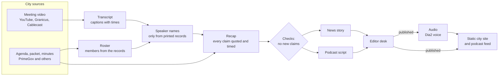
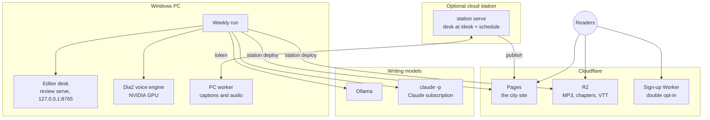
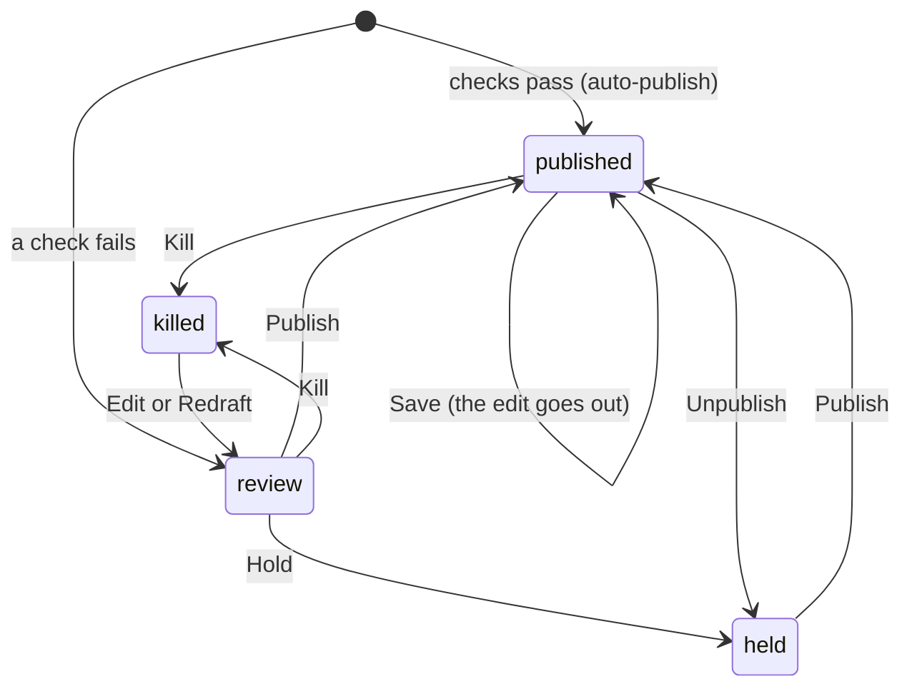
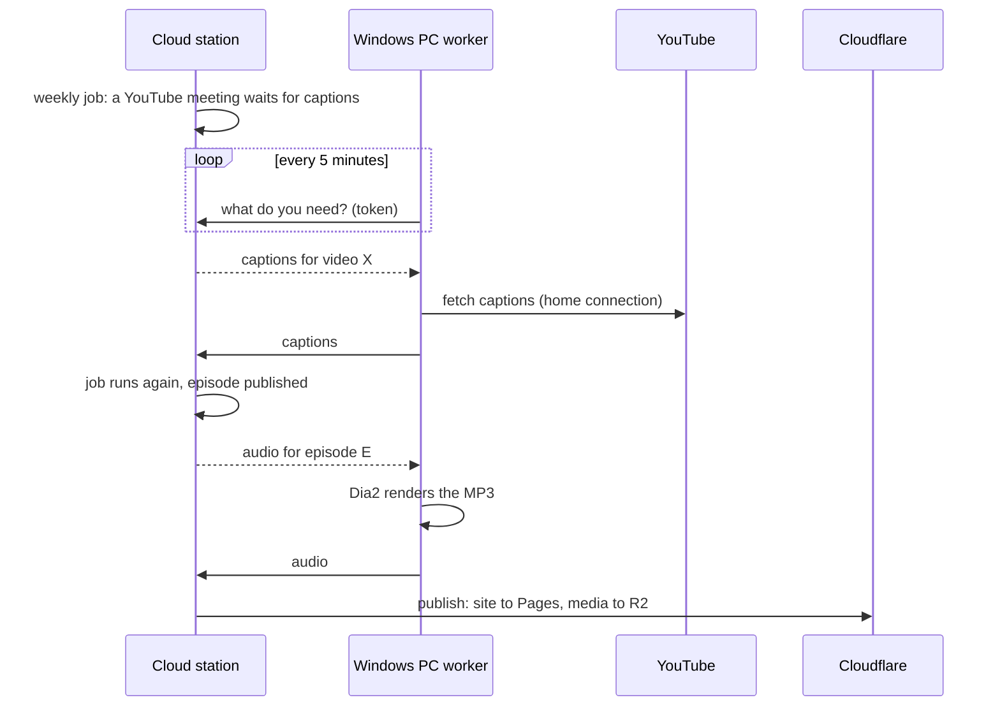

# CivicCast Brief user manual

This manual covers **CivicCast Brief 0.2.0**. It has four parts:

1. [New users](#1-new-users): what the program is and your first hour with it.
2. [Editors (no technical background needed)](#2-editors): the desk, the buttons, and what readers see.
3. [Technical users](#3-technical-users): install, commands, settings files, hosting and the PC worker.
4. [Architecture](#4-architecture): how the parts fit, with diagrams.

The step-by-step setup guide is [set-up-a-city.md](set-up-a-city.md). This manual explains the
whole program and points to that guide for exact command options.

---

## 1. New users

### What CivicCast Brief does

CivicCast Brief answers one question for a town: *what did my local government just do?*

It reads a city's public meeting videos and documents and makes four things from each meeting:

- a **transcript** with times and, where the records allow, speaker names;
- a **recap** where every claim quotes the meeting word for word, with the time it was said;
- a **news story** where every paragraph, vote and quote links to its moment in the video;
- a **podcast episode** with two hosts, chapters and a transcript.

It then builds a **city website** with the stories, an audio player, transcript pages, board,
topic and monthly archive pages, search and a podcast feed. An example is live at
[longmont.civiccastbrief.org](https://longmont.civiccastbrief.org).

### What it will not do

- It does not make things up. A checker drops any claim, number or name that is not in the
  meeting's own words or documents.
- It does not guess who is speaking. A speaker is named only when a city record prints the name
  (the roll call, the member list, the agenda). Everyone else stays "unknown".
- It is not a full newsroom. There are no beats, opinion pieces, records requests or ads.

### What you need

- A Windows 11 PC. The program is built and tested on Windows.
- Google Chrome (some city sites can only be read through it).
- Ollama, or a Claude subscription, for the writing model.
- For audio: an NVIDIA GPU for the Dia2 voice engine.

### Your first hour

1. **Install.** Double-click `install.cmd` in a copy of the code, or run the one-line command in
   [Install](#install). It installs everything for your user, with no administrator rights, and
   says what is still missing.
2. **Open the desk.** Double-click `desk.cmd`. Your browser opens the editor desk at
   `http://127.0.0.1:8765/`. Keep the desk's window open; closing it stops the desk.
3. **Find your city's sources.** On the desk, go to **Sources > Find a city's sources**. Type the
   city's name and state (and its website if you know it), press **Search**, tick what it found,
   and press **Add**.
4. **Check them.** Press **Check all sources**. Each body (council, board, commission) shows
   READ with its newest meeting, or NOT READ with the reason.
5. **Run the week.** Run the weekly command (see [The weekly run](#the-weekly-run)), or ask your
   technical person to schedule it. New meetings appear on the desk.

---

## 2. Editors

You do not need to know any code to edit. Everything here happens in the browser.

### The desk's front page

The front page is the control room:

- **Problems**: what needs you. Items that failed their checks, items still waiting for review,
  and (on a station) a weekly run that failed.
- **What went out**: everything published, each with **Edit**, **Unpublish** and **Kill**.
- On a station, it also shows the last run, the next run and any publish waiting to go out,
  with **Run now**.

Below that, every item is listed, with a tab for each state.

### Items and their states

An item is an **episode** (speakers, recap and podcast script) or an **article** (the news
story). Each item is in one state:

| State | Meaning | Reaches the site |
|---|---|---|
| review | waiting for an editor | no |
| held | set aside | no |
| killed | will not run until it is edited or redrafted | no |
| published | out on the site | yes |

**Auto-publish is always on.** An item that passes every check is published as soon as the
weekly run makes it. An item that fails a check is held in review and never goes out by itself.
Your job is mostly the Problems list.

### The buttons

| Button | What it does |
|---|---|
| **Save** | Keeps your edits. A published item stays published, so your change goes out. Any other item goes back to review. |
| **Publish** | Puts the item out with its exact saved text. |
| **Unpublish** | Takes a published item off the site and holds it. |
| **Hold** / **Kill** | Keeps an item off the site. A killed item needs an edit or a redraft before it can be published. |
| **Redraft** | Sends your note and the draft to the writing model. The new draft is checked and goes to review. It takes a few minutes. |
| **Regenerate audio** | (episodes) Asks for new audio for the current script. |

Every button shows that it is working, and every page says what happened. The item's history
lists every action.

### The other desk pages

- **City**: the city's name, short web name, state and contact emails.
- **Sources**: where meetings come from. Add, edit, check or remove a source.
- **Roster**: each body's members and the record each one was read from. You do not type
  members in; the weekly run reads them from the meetings' own records.
- **Models**: which writing model each task uses, per body.

### Signing in

Every desk page needs a signed-in editor, on your own PC and on a server. The first time you
open a new desk, make its account on the sign-up page: the first account owns the desk, and
after that sign-up is closed. Sessions last 7 days. After 10 wrong passwords an account locks
for 15 minutes.

### What readers see

- The front page leads with the newest story. Each story has its own page.
- Every paragraph, vote and quote links to the second in the meeting video where it was said,
  or to the page of the packet or minutes it came from.
- Each meeting has an audio episode with chapters and a transcript.
- Board, topic and monthly archive pages, search, a podcast page and a feed.
- A page that does not exist shows "Page not found".
- Visits are counted with Cloudflare Web Analytics, which sets no cookies.

---

## 3. Technical users

### Install

On Windows, from a copy of the code, double-click `install.cmd`. With no copy, run in PowerShell:

```
powershell -ExecutionPolicy Bypass -c "irm https://raw.githubusercontent.com/scottconverse/civiccast-brief/main/install.ps1 | iex"
```

The script installs uv, the Python packages (uv brings Python 3.12 if needed), ffmpeg and yt-dlp,
checks for Chrome and for Ollama with the writer model, and writes `desk.cmd`. Add `-Diarize`
for speaker diarization (large download). Where each part goes is listed in
[set-up-a-city.md, Install](set-up-a-city.md#install). A fresh Windows runner on GitHub runs
this installer whenever it changes.

From a developer checkout: `uv sync`, then use `.venv\Scripts\python.exe`.

### The commands

| Command | What it does |
|---|---|
| `python -m civiccast_brief setup` | start a city folder: `city.json` and `roster.json` |
| `python -m civiccast_brief city find` / `city check` | find a city's meeting sources (no AI model), then check each body reads |
| `python -m civiccast_brief tools` | install or update yt-dlp in CivicCast Brief's own folder |
| `python -m civiccast_brief evidence` | what the record holds for one meeting |
| `python -m civiccast_brief.meeting run` | one meeting: transcript, speakers, recap |
| `python -m civiccast_brief.script write` / `check` / `repair` / `roundup` | the podcast script and its no-new-claims check |
| `python -m civiccast_brief.article write` / `check` / `stage` / `title` | the news story and its check |
| `python -m civiccast_brief.review serve` / `export` | the editor desk, and the export of published items |
| `python -m civiccast_brief.audio` | render a script to MP3, chapters and VTT |
| `python -m civiccast_brief.site build` / `home` | build a city site, or the civiccastbrief.org home page |
| `python -m civiccast_brief.weekly run` | the whole week, steps 3 to 7, for every new meeting |
| `python -m civiccast_brief.weekly publish` | rebuild the site from what is published now |
| `python -m civiccast_brief.station serve` | the desk at `/desk` plus the weekly job on a schedule |
| `python -m civiccast_brief.station deploy cloudflare` / `folder` | put the site and media online |
| `python -m civiccast_brief.station worker` | on a Windows PC: fetch captions and make audio for a cloud station |

Each command takes `--help`.

### The city folder

| File | Holds | Written by |
|---|---|---|
| `city.json` | site, podcast and capture settings | `setup`, then you |
| `sources.json` | where meetings come from, and which bodies each covers | `city find`, the desk's Sources page |
| `roster.json`, `rosters/<body>.json` | members, each with the record that printed them | the weekly run |
| `models.json` | the writing model per task and body | the desk's Models page |
| `city-check.json` | the last source check | `city check`, **Check all sources** |

Optional `city.json` keys for the site: `apple_podcasts_url`, `spotify_url`, `email_signup` with
`signup_url`, and `desk_url` (adds an "Editor sign-in" link to the footer).

### Meeting sources

The weekly run reads PrimeGov, Granicus, YouTube channels, Cablecast (Reflect), CivicWeb
(iCompass), CivicClerk, CivicPlus, eScribe and Laserfiche WebLink, plus plain web pages of
meeting documents, public Google Drive folders and OneDrive shares. Where readable, a PrimeGov
meeting also gives its packet and minutes. `city find` lists the platforms it found but cannot
read yet, so they can be added by hand.

### Models

A model pick is `provider:model`. `claude:<model>` runs `claude -p` on a Claude subscription
(signed in with `claude` or `claude setup-token`); the program removes any `ANTHROPIC_API_KEY`
from that process, so no API key is used. `ollama:<model>` runs through Ollama at
`127.0.0.1:11434`. Out of the box City Council uses Claude and every other body uses
`deepseek-v4.1-flash:1017-cloud` through Ollama.

### Voices

The default voice engine is **Dia2**; Chatterbox is the other choice (`--engine chatterbox`).
Both run as plain Windows Python on an NVIDIA GPU. No hosted text-to-speech is used. The
bake-off that picked Dia2 is in [voice-bakeoff.md](voice-bakeoff.md).

### The weekly run

```
python -m civiccast_brief.weekly run --city cities/yourcity --work runs/weekly --db desk.db --episodes site-in --media media --site-out site --base-url https://yourcity.example.org --media-base-url https://media.example.org
```

It finds the last 7 days of meetings and, for each new one, saves the agenda, makes the
transcript, speakers and recap, writes and checks the script and the story, and stages both on
the desk. With two or more meetings, a weekly roundup follows. Then it exports what is
published, makes audio for new episodes and builds the site. `weekly-state.json` records each
step, so running the same command again retries only what failed. Exit 0 means everything
finished.

To run it every week, add a Windows scheduled task, or run the station (below).

### Hosting

- **Cloudflare (the default).** `station deploy cloudflare` uploads new or changed media to an
  R2 bucket and deploys the site to Cloudflare Pages with wrangler, which keeps the `_headers`
  file. The token comes from `CLOUDFLARE_API_TOKEN` or, on Windows, Credential Manager under
  `CivicCastBrief/cloudflare-deploy`. It is never printed.
- **Any web server.** `station deploy folder` copies the site and media into folders a web
  server serves, and removes only files it put there itself.
- **Hostinger.** See [run-on-hostinger.md](run-on-hostinger.md). That guide has not been run
  on a Linux server.

### The station and the PC worker

`station serve --config station.json` runs the desk at `/desk` and the weekly job on its
schedule. Its optional `publish` commands run after each job, and about half a minute after an
editor publishes, edits or kills a public item.

A station on a cloud server cannot fetch YouTube captions (YouTube asks data-center addresses to
sign in) and has no GPU for the voice. A Windows PC on a home connection runs
`station worker --station <address>`. Every 5 minutes it asks what the station needs, fetches
captions and makes audio, and sends the files back. Station and PC share one token, from
`CIVICCAST_WORKER_TOKEN` or Credential Manager `CivicCastBrief/worker-token`. Details:
[set-up-a-city.md, section 10](set-up-a-city.md#10-a-cloud-station-with-a-windows-pc-worker).

### Email sign-up and podcast directories

The email sign-up is a Cloudflare Worker in `worker/signup` (TypeScript, double opt-in). The
podcast feed follows the Apple Podcasts and Spotify formats. Neither is connected to a real
sending account or directory listing yet; setup steps are in [email-signup.md](email-signup.md)
and [podcast-directories.md](podcast-directories.md).

### Tests

Tests run on GitHub Actions on Windows and Ubuntu for every code change (`uv run ruff check`,
`uv run ruff format --check`, `uv run pytest`). The sign-up worker has its own type check and
tests (`npm run typecheck`, `npm test` in `worker/signup`). Docs-only changes do not start
the test run.

---

## 4. Architecture

### The pipeline

Every step writes files to the meeting's folder, so a stopped run picks up where it left off.



### The parts



The code is Python 3.12 in `src/civiccast_brief`, one package per step: `record` (capture and
city records), `meeting` (transcript, speakers, recap), `script`, `article`, `audio`, `review`
(the desk), `episode`, `site`, `weekly`, `station`. The sign-up Worker is TypeScript in
`worker/signup`.

### An item's life on the desk



### A cloud station with a PC worker



### Why it is built this way

- **Files between steps.** Each step reads and writes plain JSON and text in the meeting folder,
  so any step can be rerun, checked or replaced on its own.
- **Checks before people.** Claims are checked against the transcript and documents before an
  editor sees them, so the editor's time goes to what failed.
- **A static site.** The public site is plain files: cheap to host, fast, and nothing to attack.
- **Windows first.** Capture, voice and the desk run on an ordinary Windows PC. A cloud server is
  optional and takes only the parts that do not need a home connection or a GPU.
